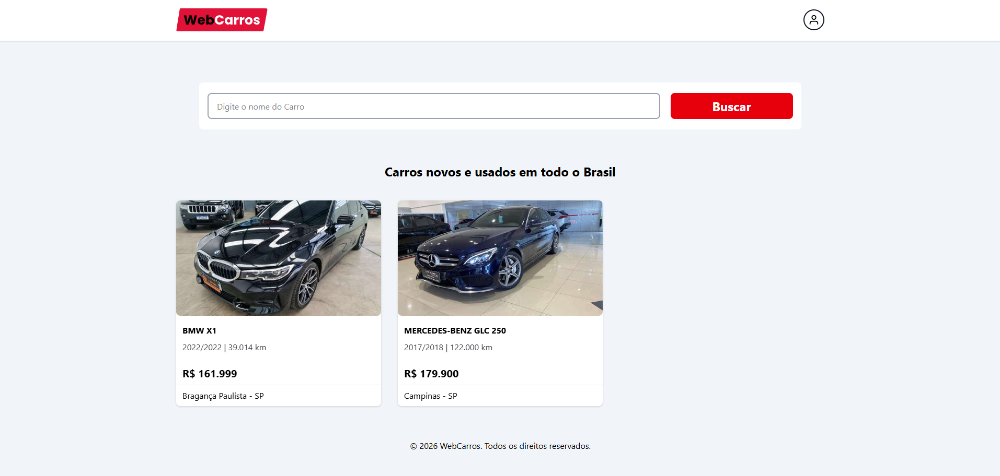
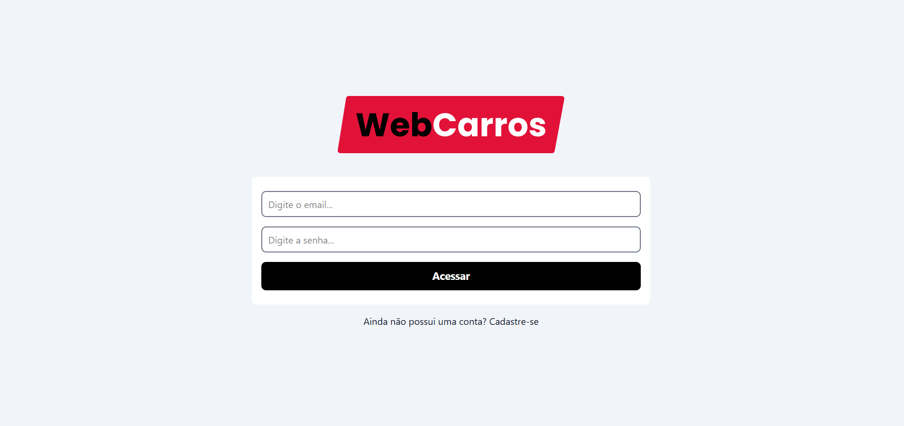
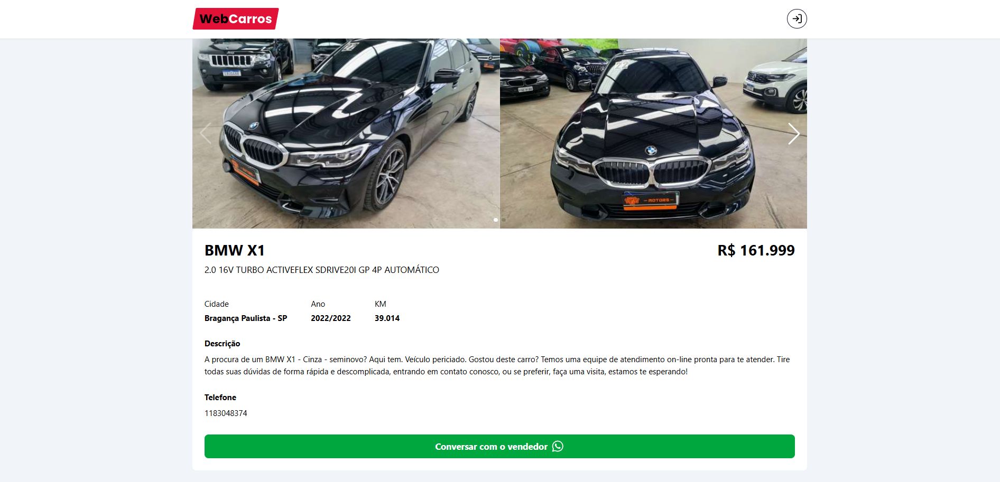
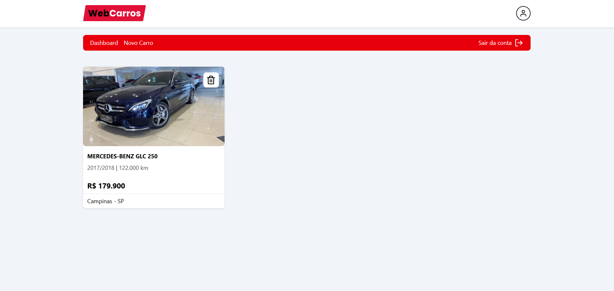
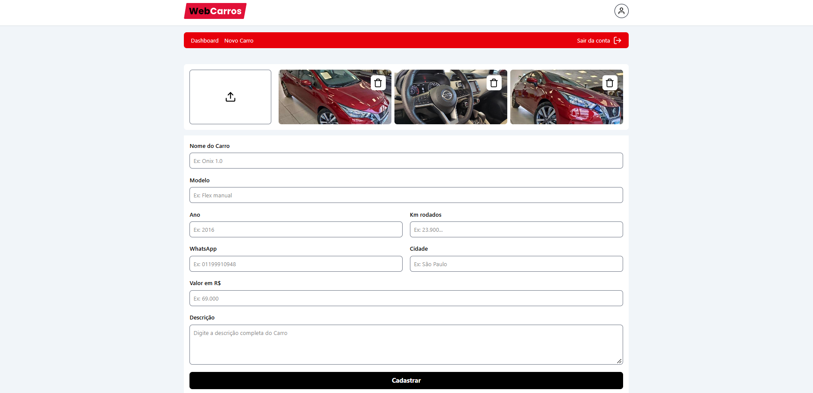

<h1 align="center">🚗 WebCarros</h1>

<p align="center">
  <a href="#-português">🇧🇷 Português</a> •
  <a href="#-english">🇺🇸 English</a>
</p>

<p align="center">
  
  
  
  
  
</p>

<p align="center">
  
</p>

---

## 🇧🇷 Português

### 📖 Sobre o projeto

O **WebCarros** é uma plataforma web para compra e venda de veículos. Usuários podem navegar pelos anúncios, buscar carros pelo nome, ver os detalhes de cada veículo com galeria de fotos e entrar em contato direto com o vendedor pelo WhatsApp. Usuários autenticados possuem um painel para cadastrar e gerenciar seus próprios anúncios.

### ✨ Funcionalidades

- 🔐 Cadastro e login de usuários com **Firebase Authentication**
- 🏠 Listagem de todos os carros anunciados, ordenados pelos mais recentes
- 🔎 Busca de veículos por nome
- 🖼️ Página de detalhes com carrossel de imagens (**Swiper**)
- 💬 Contato direto com o vendedor via **WhatsApp**
- 📊 Painel (dashboard) com os anúncios do usuário logado
- ➕ Cadastro de novos carros com upload de imagens (**Firebase Storage**)
- 🗑️ Exclusão de anúncios e imagens
- ✅ Validação de formulários com **React Hook Form** + **Zod**
- 🔔 Notificações com **React Hot Toast**
- 🛡️ Rotas privadas protegidas por autenticação

### 🖼️ Screenshots

| Login | Home |
| :---: | :---: |
|  |  |

| Detalhes do carro | Painel |
| :---: | :---: |
|  |  |

| Novo carro |
| :---: |
|  |

### 🛠️ Tecnologias

- [React 19](https://react.dev/)
- [TypeScript](https://www.typescriptlang.org/)
- [Vite](https://vite.dev/)
- [Tailwind CSS 4](https://tailwindcss.com/)
- [Firebase](https://firebase.google.com/) (Authentication, Firestore e Storage)
- [React Router](https://reactrouter.com/)
- [React Hook Form](https://react-hook-form.com/) + [Zod](https://zod.dev/)
- [Swiper](https://swiperjs.com/)
- [React Hot Toast](https://react-hot-toast.com/)
- [React Icons](https://react-icons.github.io/react-icons/)
- [UUID](https://github.com/uuidjs/uuid)

### 🚀 Como executar

**Pré-requisitos:** [Node.js](https://nodejs.org/) instalado e um projeto criado no [Firebase](https://console.firebase.google.com/) com Authentication (e-mail/senha), Firestore e Storage habilitados.

```bash
# Clone o repositório
git clone https://github.com/Pedrohmdn/webcars.git

# Acesse a pasta do projeto
cd webcars

# Instale as dependências
npm install
```

Crie um arquivo `.env.local` na raiz do projeto com as credenciais do Firebase:

```env
VITE_FIREBASE_API_KEY=
VITE_FIREBASE_AUTH_DOMAIN=
VITE_FIREBASE_PROJECT_ID=
VITE_FIREBASE_STORAGE_BUCKET=
VITE_FIREBASE_MESSAGING_SENDER_ID=
VITE_FIREBASE_APP_ID=
```

```bash
# Inicie o servidor de desenvolvimento
npm run dev
```

A aplicação estará disponível em `http://localhost:5173`.

### 📁 Estrutura de pastas

```
src/
├── assets/        # Imagens e arquivos estáticos
├── components/    # Componentes reutilizáveis e layouts
├── contexts/      # Context API (autenticação)
├── pages/         # Páginas da aplicação
├── routes/        # Rota privada
├── services/      # Configuração do Firebase
├── styles/        # Estilos globais
├── main.tsx
└── routes.tsx     # Definição das rotas
```

---

## 🇺🇸 English

### 📖 About

**WebCarros** is a web platform for buying and selling vehicles. Users can browse listings, search cars by name, view each vehicle's details with a photo gallery and contact the seller directly via WhatsApp. Authenticated users have a dashboard to create and manage their own listings.


### ✨ Features

- 🔐 User sign up and login with **Firebase Authentication**
- 🏠 List of all advertised cars, sorted by most recent
- 🔎 Search vehicles by name
- 🖼️ Details page with image carousel (**Swiper**)
- 💬 Contact the seller directly via **WhatsApp**
- 📊 Dashboard with the logged-in user's listings
- ➕ Register new cars with image upload (**Firebase Storage**)
- 🗑️ Delete listings and images
- ✅ Form validation with **React Hook Form** + **Zod**
- 🔔 Notifications with **React Hot Toast**
- 🛡️ Private routes protected by authentication

### 🖼️ Screenshots

| Login | Home |
| :---: | :---: |
|  |  |

| Car details | Dashboard |
| :---: | :---: |
|  |  |

| New car |
| :---: |
|  |

### 🛠️ Tech stack

- [React 19](https://react.dev/)
- [TypeScript](https://www.typescriptlang.org/)
- [Vite](https://vite.dev/)
- [Tailwind CSS 4](https://tailwindcss.com/)
- [Firebase](https://firebase.google.com/) (Authentication, Firestore and Storage)
- [React Router](https://reactrouter.com/)
- [React Hook Form](https://react-hook-form.com/) + [Zod](https://zod.dev/)
- [Swiper](https://swiperjs.com/)
- [React Hot Toast](https://react-hot-toast.com/)
- [React Icons](https://react-icons.github.io/react-icons/)
- [UUID](https://github.com/uuidjs/uuid)

### 🚀 Getting started

**Requirements:** [Node.js](https://nodejs.org/) installed and a [Firebase](https://console.firebase.google.com/) project with Authentication (email/password), Firestore and Storage enabled.

```bash
# Clone the repository
git clone https://github.com/Pedrohmdn/webcars.git

# Go to the project folder
cd webcars

# Install dependencies
npm install
```

Create a `.env.local` file in the project root with your Firebase credentials:

```env
VITE_FIREBASE_API_KEY=
VITE_FIREBASE_AUTH_DOMAIN=
VITE_FIREBASE_PROJECT_ID=
VITE_FIREBASE_STORAGE_BUCKET=
VITE_FIREBASE_MESSAGING_SENDER_ID=
VITE_FIREBASE_APP_ID=
```

```bash
# Start the development server
npm run dev
```

The app will be available at `http://localhost:5173`.

### 📁 Folder structure

```
src/
├── assets/        # Images and static files
├── components/    # Reusable components and layouts
├── contexts/      # Context API (authentication)
├── pages/         # Application pages
├── routes/        # Private route
├── services/      # Firebase configuration
├── styles/        # Global styles
├── main.tsx
└── routes.tsx     # Route definitions
```

---

